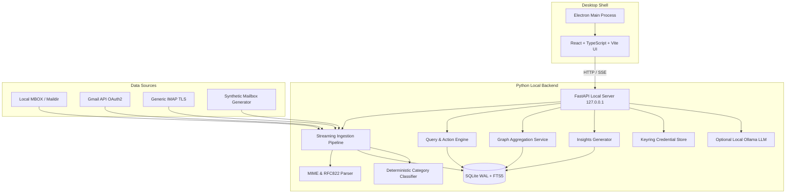

# MailGraph Implementation Plan

> **For agentic workers:** REQUIRED SUB-SKILL: Use superpowers:subagent-driven-development to implement this plan task-by-task. Steps use checkbox (`- [ ]`) syntax for tracking.

**Goal:** Build a complete, functional, polished local-first desktop application for email intelligence, graph visualization, sender management, and safe bulk cleanup.

**Architecture:** A local Python 3.11+ backend (FastAPI, SQLite with FTS5, streaming MIME/MBOX/IMAP/Gmail ingestion, graph aggregation, deterministic rule classification, and safe query/cleanup engine) paired with an Electron desktop shell hosting a React + TypeScript + Vite frontend (featuring Cytoscape.js multi-resolution graph, virtualized message & sender exploration tables, preview/confirmation workflows, and timeline analytics). All email data, indexes, and credentials remain strictly local.

**Architecture Diagram:**

**Tech Stack:** 
- Backend: Python 3.11, FastAPI, Uvicorn, SQLite3 (WAL mode, FTS5), Pydantic v2, NetworkX, Keyring, Bleach/nh3.
- Desktop Shell & Frontend: Electron, React 19, TypeScript, Vite, Tailwind CSS, Cytoscape.js, Lucide Icons.
- Storage: Local SQLite database `%APPDATA%/Mailgraph/mailgraph.db` with automated migrations and FTS5 full-text indexing.
- Providers: MBOX file parser, Gmail API (OAuth loopback), Generic IMAP, Synthetic Mailbox Generator.

**Spec:** [agent-spec.md](file:///d:/.Programs/Programs/GitHub/mailgraph/agent-spec.md)

## Global Constraints
- Local-first: 100% offline-capable after import; zero cloud sync, zero telemetry, zero remote tracking scripts/fonts.
- AI is strictly optional: zero core feature depends on AI, API keys, or GPU; if local Ollama is present, results are inspectable and cannot autonomously mutate email.
- Destructive safety: preview and execution use identical compiled queries; no permanent delete by default (only Trash and Archive); protected senders/domains are strictly excluded; undo logging is mandatory.
- Granular Git Commits: commit frequently after each task and verified milestone.

---

### Task 0: Project Scaffolding & Git Foundation

**Files:**
- Create: `backend/app/__init__.py`
- Create: `backend/app/config.py`
- Create: `backend/app/db/__init__.py`
- Create: `backend/app/db/database.py`
- Create: `backend/app/db/schema.py`
- Create: `backend/app/db/migrations.py`
- Create: `backend/tests/__init__.py`
- Create: `backend/tests/test_database.py`
- Create: `requirements.txt`
- Create: `README.md`

**Interfaces:**
- Consumes: Python standard library, sqlite3
- Produces: Database connection pool, schema initialization, table creation for all 15 tables (`accounts`, `folders`, `messages`, `message_addresses`, `senders`, `threads`, `attachments`, `categories`, `message_categories`, `protection_rules`, `saved_queries`, `operations`, `operation_items`, `sync_runs`, `insights`, `messages_fts`).

- [ ] **Step 1: Write test for database initialization and schema creation**
- [ ] **Step 2: Run test to verify failure**
- [ ] **Step 3: Implement database configuration, schema DDL, and migration runner**
- [ ] **Step 4: Run test to verify all 15 tables and FTS5 index are created properly**
- [ ] **Step 5: Commit changes**

---

### Task 1: Ingestion Pipeline & Normalization (MIME, RFC822, MBOX, Synthetic)

**Files:**
- Create: `backend/app/ingestion/__init__.py`
- Create: `backend/app/ingestion/mime_parser.py`
- Create: `backend/app/ingestion/pipeline.py`
- Create: `backend/app/providers/__init__.py`
- Create: `backend/app/providers/base.py`
- Create: `backend/app/providers/mbox.py`
- Create: `backend/app/providers/synthetic.py`
- Create: `backend/tests/test_mime_parser.py`
- Create: `backend/tests/test_mbox_ingestion.py`
- Create: `backend/tests/test_synthetic_generator.py`

**Interfaces:**
- Consumes: `backend/app/db/database.py`
- Produces: `ParsedEmail` dataclass, streaming `MboxProvider`, `SyntheticMailboxGenerator`, `IngestionPipeline` with batch upserts, deduplication, thread linking, and progress callbacks.

- [ ] **Step 1: Write tests for MIME parser, address normalization, MBOX streaming, and synthetic mailbox generation**
- [ ] **Step 2: Run tests to verify failure**
- [ ] **Step 3: Implement MIME parser, MBOX adapter, synthetic generator, and IngestionPipeline**
- [ ] **Step 4: Run tests to verify 100% pass on message ingestion, deduplication, and thread extraction**
- [ ] **Step 5: Commit changes**

---

### Task 2: Deterministic Categorization & Explainable Intelligence

**Files:**
- Create: `backend/app/classification/__init__.py`
- Create: `backend/app/classification/rules_engine.py`
- Create: `backend/app/insights/__init__.py`
- Create: `backend/app/insights/insight_service.py`
- Create: `backend/tests/test_classification.py`
- Create: `backend/tests/test_insights.py`

**Interfaces:**
- Consumes: Normalized message records and metadata
- Produces: Category assignment with confidence score & provenance; "What am I missing?" insights generation (zombie newsletters, unreplied threads, storage dominators).

- [ ] **Step 1: Write tests for rule classification (newsletter, transactional, receipt, security, personal) and insights generator**
- [ ] **Step 2: Run tests to verify failure**
- [ ] **Step 3: Implement rules_engine.py and insight_service.py**
- [ ] **Step 4: Run tests to verify correct categorization and insight detection**
- [ ] **Step 5: Commit changes**

---

### Task 3: Query Compiler, FTS5 Search & Safe Action Engine

**Files:**
- Create: `backend/app/search/__init__.py`
- Create: `backend/app/search/query_compiler.py`
- Create: `backend/app/search/search_service.py`
- Create: `backend/app/actions/__init__.py`
- Create: `backend/app/actions/engine.py`
- Create: `backend/app/security/__init__.py`
- Create: `backend/app/security/sanitizer.py`
- Create: `backend/tests/test_query_compiler.py`
- Create: `backend/tests/test_actions_engine.py`

**Interfaces:**
- Consumes: Query AST (JSON), database connection, protection rules
- Produces: Safe SQL with parameter binding, preview simulation (target count, bytes, protected exclusions), action execution (trash, archive), undo logging.

- [ ] **Step 1: Write tests for AST query compiler, SQL injection prevention, protection exclusion, preview calculation, and undo restoration**
- [ ] **Step 2: Run tests to verify failure**
- [ ] **Step 3: Implement query_compiler.py, search_service.py, actions/engine.py, sanitizer.py**
- [ ] **Step 4: Run tests to verify query compilation accuracy, protection safety, and undo mechanics**
- [ ] **Step 5: Commit changes**

---

### Task 4: Graph Aggregation & Analytics Service

**Files:**
- Create: `backend/app/graph/__init__.py`
- Create: `backend/app/graph/graph_service.py`
- Create: `backend/tests/test_graph_service.py`

**Interfaces:**
- Consumes: SQLite database messages, senders, domains
- Produces: Multi-resolution graph data (domain -> sender -> thread), node metrics (volume, unread, size, date span), edges, clustering summaries for Cytoscape.js.

- [ ] **Step 1: Write test for domain and sender graph aggregation and filtering**
- [ ] **Step 2: Run test to verify failure**
- [ ] **Step 3: Implement graph_service.py with SQL aggregations and node metric calculators**
- [ ] **Step 4: Run test to verify graph generation and performance on aggregated datasets**
- [ ] **Step 5: Commit changes**

---

### Task 5: Live Mail Providers (Gmail OAuth & Generic IMAP) & Optional Local AI

**Files:**
- Create: `backend/app/providers/imap.py`
- Create: `backend/app/providers/gmail.py`
- Create: `backend/app/security/credential_store.py`
- Create: `backend/app/ai/__init__.py`
- Create: `backend/app/ai/local_llm.py`
- Create: `backend/tests/test_providers.py`
- Create: `backend/tests/test_local_ai.py`

**Interfaces:**
- Consumes: Network / local Ollama endpoint
- Produces: IMAP connection adapter, Gmail OAuth client with loopback auth and OS keyring storage, optional local LLM translation to structured query AST.

- [ ] **Step 1: Write unit and mock integration tests for IMAP, Gmail adapter lifecycle, keyring storage, and local LLM query translator**
- [ ] **Step 2: Run tests to verify failure**
- [ ] **Step 3: Implement imap.py, gmail.py, credential_store.py, and local_llm.py**
- [ ] **Step 4: Run tests to verify mock provider operations and fallback when Ollama is offline**
- [ ] **Step 5: Commit changes**

---

### Task 6: FastAPI Application & REST/SSE Endpoints

**Files:**
- Create: `backend/app/models/__init__.py`
- Create: `backend/app/models/schemas.py`
- Create: `backend/app/api/__init__.py`
- Create: `backend/app/api/routes_accounts.py`
- Create: `backend/app/api/routes_messages.py`
- Create: `backend/app/api/routes_senders.py`
- Create: `backend/app/api/routes_graph.py`
- Create: `backend/app/api/routes_cleanup.py`
- Create: `backend/app/api/routes_attachments.py`
- Create: `backend/app/api/routes_timeline.py`
- Create: `backend/app/api/routes_insights.py`
- Create: `backend/app/api/routes_settings.py`
- Create: `backend/app/main.py`
- Create: `backend/tests/test_api_endpoints.py`

**Interfaces:**
- Consumes: All backend services
- Produces: Complete HTTP API + SSE endpoint for scan and action progress.

- [ ] **Step 1: Write integration tests for API routes using FastAPI TestClient**
- [ ] **Step 2: Run tests to verify failure**
- [ ] **Step 3: Implement all API route handlers and main.py application**
- [ ] **Step 4: Run tests to verify full API functionality**
- [ ] **Step 5: Commit changes**

---

### Task 7: Desktop UI Architecture & Design System (Vite, React, TypeScript, Electron)

**Files:**
- Create: `apps/desktop/package.json`
- Create: `apps/desktop/vite.config.ts`
- Create: `apps/desktop/tsconfig.json`
- Create: `apps/desktop/index.html`
- Create: `apps/desktop/electron/main.cjs`
- Create: `apps/desktop/electron/preload.cjs`
- Create: `apps/desktop/src/index.css` (custom dark/technical design tokens)
- Create: `apps/desktop/src/main.tsx`
- Create: `apps/desktop/src/types/api.ts`
- Create: `apps/desktop/src/api/client.ts`
- Create: `apps/desktop/src/components/Sidebar.tsx`
- Create: `apps/desktop/src/components/Header.tsx`
- Create: `apps/desktop/src/components/Button.tsx`
- Create: `apps/desktop/src/components/Modal.tsx`
- Create: `apps/desktop/src/components/Badge.tsx`
- Create: `apps/desktop/src/components/Toast.tsx`
- Create: `apps/desktop/src/App.tsx`

**Interfaces:**
- Consumes: Local backend API
- Produces: Professional, technical desktop shell, navigation, responsive layout, theme tokens, and notifications.

- [ ] **Step 1: Setup npm dependencies, Electron configs, and Vite build configuration**
- [ ] **Step 2: Implement design system tokens, layout shell, sidebar, and API client**
- [ ] **Step 3: Verify build and frontend rendering**
- [ ] **Step 4: Commit changes**

---

### Task 8: Dedicated Sender Management & Message Explorer

**Files:**
- Create: `apps/desktop/src/features/senders/SendersView.tsx`
- Create: `apps/desktop/src/features/senders/SenderDetailPanel.tsx`
- Create: `apps/desktop/src/features/messages/MessagesView.tsx`
- Create: `apps/desktop/src/features/messages/MessageTable.tsx`
- Create: `apps/desktop/src/features/messages/MessageDetailModal.tsx`
- Create: `apps/desktop/src/features/messages/FilterBar.tsx`

**Interfaces:**
- Consumes: `GET /api/senders`, `GET /api/messages`, `GET /api/messages/{id}`
- Produces: Full sender management UI (search, sort by message count/size, multi-select senders, bulk cleanup trigger), advanced message filtering, virtualized message list, sanitized email preview.

- [ ] **Step 1: Implement SendersView with multi-selection, volume ranking, and quick cleanup action button**
- [ ] **Step 2: Implement MessagesView with live filters, category tags, sanitized HTML reader, and selection**
- [ ] **Step 3: Verify frontend interaction and sender inspection**
- [ ] **Step 4: Commit changes**

---

### Task 9: Interactive Graph Explorer (Cytoscape.js) & Overview Dashboard

**Files:**
- Create: `apps/desktop/src/features/overview/OverviewView.tsx`
- Create: `apps/desktop/src/features/graph/GraphView.tsx`
- Create: `apps/desktop/src/features/graph/GraphControls.tsx`
- Create: `apps/desktop/src/features/graph/NodeDetailPanel.tsx`

**Interfaces:**
- Consumes: `GET /api/graph`, `GET /api/overview`
- Produces: Multi-resolution interactive domain/sender network visualization, zoom/pan/filter controls, node selection sync with message list, and mailbox health overview dashboard.

- [ ] **Step 1: Implement OverviewView with mailbox statistics, storage breakdown, top senders, and recent scan status**
- [ ] **Step 2: Implement GraphView using Cytoscape.js with dark/technical styling, node metric scaling, domain clustering, and synchronized details panel**
- [ ] **Step 3: Verify graph rendering and interaction**
- [ ] **Step 4: Commit changes**

---

### Task 10: Cleanup Studio, Previews, Confirmations & Undo Workflows

**Files:**
- Create: `apps/desktop/src/features/cleanup/CleanupStudio.tsx`
- Create: `apps/desktop/src/features/cleanup/SimulationPreview.tsx`
- Create: `apps/desktop/src/features/cleanup/ConfirmationModal.tsx`
- Create: `apps/desktop/src/features/cleanup/AuditLogView.tsx`

**Interfaces:**
- Consumes: `POST /api/cleanup/preview`, `POST /api/cleanup/execute`, `POST /api/cleanup/undo`, `GET /api/cleanup/operations`
- Produces: Safe cleanup workflow with exact target simulation, exclusion of protected messages, explicit confirmation step naming exact action and counts, live execution progress, and audit trail with undo.

- [ ] **Step 1: Implement SimulationPreview showing target counts, affected threads, estimated storage recovery, and protected sender exclusions**
- [ ] **Step 2: Implement ConfirmationModal requiring explicit action button (e.g., "Move 842 messages to Trash") and audit log with undo action**
- [ ] **Step 3: Verify complete preview -> confirm -> execute -> undo lifecycle**
- [ ] **Step 4: Commit changes**

---

### Task 11: Timeline, Attachments, Insights & Settings Views

**Files:**
- Create: `apps/desktop/src/features/timeline/TimelineView.tsx`
- Create: `apps/desktop/src/features/attachments/AttachmentsView.tsx`
- Create: `apps/desktop/src/features/insights/InsightsView.tsx`
- Create: `apps/desktop/src/features/settings/SettingsView.tsx`

**Interfaces:**
- Consumes: `GET /api/timeline`, `GET /api/attachments`, `GET /api/insights`, `GET/POST /api/settings`
- Produces: Time machine volume histograms, duplicate attachment grouping & local export, explainable "What am I missing?" cards, account management (MBOX, Gmail, IMAP, Synthetic demo generation), privacy controls, and protected sender rules.

- [ ] **Step 1: Implement TimelineView and AttachmentsView with duplicate content detection**
- [ ] **Step 2: Implement InsightsView and SettingsView with synthetic data generator button, MBOX upload, and privacy switches**
- [ ] **Step 3: Verify complete end-to-end functionality across all 9 primary views**
- [ ] **Step 4: Commit changes**

---

### Task 12: End-to-End Verification, Documentation & Production Launch Scripts

**Files:**
- Create: `scripts/run_dev.py` (one-click dev launcher that starts both backend and desktop UI)
- Create: `scripts/run_desktop.py` (production desktop launcher)
- Update: `README.md` (comprehensive instructions for setup, running, privacy, and architecture)
- Create: `docs/architecture.md`
- Create: `docs/provider-support.md`

**Interfaces:**
- Consumes: Whole codebase
- Produces: One-command launch scripts, verified test suite, complete user & developer documentation.

- [ ] **Step 1: Create launcher scripts and verify smooth startup**
- [ ] **Step 2: Run all backend tests and frontend builds**
- [ ] **Step 3: Document all features, security controls, and provider instructions in README.md**
- [ ] **Step 4: Final verification and commit**
