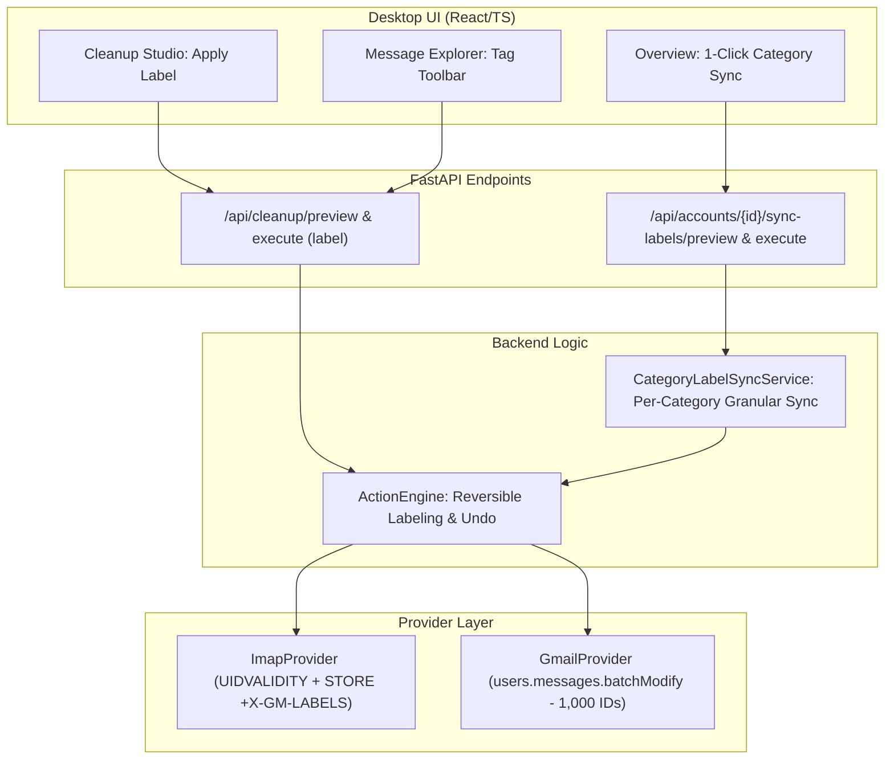

# Gmail Labeling & Tagging Implementation Plan

> **For agentic workers:** REQUIRED SUB-SKILL: Use superpowers:subagent-driven-development to implement this plan task-by-task. Steps use checkbox (`- [ ]`) syntax for tracking.

**Goal:** Implement safe, reversible Gmail labeling and tagging in MailGraph, supporting 1-click Category Sync (e.g. `MailGraph/Finance`, `MailGraph/Newsletters`), interactive labeling in Cleanup Studio and Message Explorer, and dual provider support (IMAP `X-GM-LABELS` and Gmail API `batchModify`).

**Architecture:** Extend `AbstractMailProvider`, `ImapProvider`, and `GmailProvider` with safe label mutation capabilities (`apply_labels`, `list_labels`), protected by IMAP `UIDVALIDITY` checks and Gmail API cache-busting. Extend `ActionEngine` with the `'label'` operation type, execute-time protection rules re-validation, and instant undo. Add a `CategoryLabelSyncService` for granular per-category sync with resumption support. Expose FastAPI endpoints and integrate them into the Desktop UI (Cleanup Studio, Overview banner & modal, and Message Explorer toolbar).

**Architecture Diagram:**



**Tech Stack:** Python 3.11, FastAPI, SQLite (WAL mode, FTS5), `imaplib` (RFC 6154, `X-GM-EXT-1`), Google OAuth/Gmail REST API, React 18, TypeScript, Tailwind CSS, Vite.

**Spec:** [`docs/superpowers/specs/2026-11-20-gmail-labeling-design.md`](file:///d:/.Programs/Programs/GitHub/mailgraph/docs/superpowers/specs/2026-11-20-gmail-labeling-design.md)

## Global Constraints

- Never execute destructive IMAP operations (`STORE +FLAGS (\Deleted)`, `EXPUNGE`) during labeling.
- Ingestion, search, and scanning remain strictly read-only (`readonly=True`); write mode is only permitted inside `apply_labels()`.
- IMAP UIDs must be verified against folder `UIDVALIDITY` before applying `STORE` commands.
- Gmail API `batchModify` must chunk requests at a maximum of 1,000 message IDs per call.
- Protection rules must be re-compiled and enforced at execute time (`exclude_protected=True`).
- Category Sync must log one `operations` record per category, linked by `batch_id`, enabling granular undo.
- TDD must be followed: write failing test, verify failure, implement minimal code, verify pass, commit.

---

### Task 1: Provider Abstraction & Exceptions

**Files:**
- Create: `backend/app/providers/exceptions.py`
- Modify: `backend/app/providers/base.py`
- Test: `backend/tests/test_providers.py`

**Interfaces:**
- Produces: `UIDValidityChangedError` in `backend.app.providers.exceptions`
- Produces: `supports_labels: bool = False` in `ProviderCapabilities`
- Produces: `apply_labels(provider_message_ids, add_labels, remove_labels)` and `list_labels()` on `AbstractMailProvider`

- [ ] **Step 1: Write failing test for base provider label interface**

In `backend/tests/test_providers.py`:
```python
from backend.app.providers.exceptions import UIDValidityChangedError
from backend.app.providers.base import AbstractMailProvider, ProviderCapabilities

def test_base_provider_label_interface():
    class DummyProvider(AbstractMailProvider):
        def get_capabilities(self):
            return ProviderCapabilities(supports_labels=True)
        def connect(self):
            return True
        def list_folders(self):
            return []
        def stream_messages(self, folder_id=None, limit=None):
            yield from ()

    p = DummyProvider()
    assert p.get_capabilities().supports_labels is True
    assert p.list_labels() == []
    import pytest
    with pytest.raises(NotImplementedError):
        p.apply_labels(["imap_INBOX_1"], add_labels=["MailGraph/Finance"])
```

- [ ] **Step 2: Run test to verify it fails**

Run: `python -m pytest backend/tests/test_providers.py::test_base_provider_label_interface -v`
Expected: FAIL (`ModuleNotFoundError: No module named 'backend.app.providers.exceptions'`)

- [ ] **Step 3: Implement exceptions and base interface**

Create `backend/app/providers/exceptions.py`:
```python
class ProviderError(Exception):
    """Base exception for mail provider operations."""
    pass

class UIDValidityChangedError(ProviderError):
    """Raised when an IMAP folder's UIDVALIDITY does not match cached state."""
    def __init__(self, folder: str, expected: str, actual: str):
        super().__init__(f"UIDVALIDITY mismatch for folder '{folder}': expected {expected}, got {actual}")
        self.folder = folder
        self.expected = expected
        self.actual = actual
```

Modify `backend/app/providers/base.py`:
Add `supports_labels: bool = False` to `ProviderCapabilities` dataclass.
Add to `AbstractMailProvider`:
```python
    def apply_labels(
        self,
        provider_message_ids: List[str],
        add_labels: Optional[List[str]] = None,
        remove_labels: Optional[List[str]] = None
    ) -> Dict[str, Any]:
        """Apply or remove labels on target messages on the remote server."""
        raise NotImplementedError("Label manipulation not supported by this provider.")

    def list_labels(self) -> List[str]:
        """List existing custom and system labels from the provider."""
        return []
```

- [ ] **Step 4: Run test to verify it passes**

Run: `python -m pytest backend/tests/test_providers.py::test_base_provider_label_interface -v`
Expected: PASS

- [ ] **Step 5: Commit**

```bash
git add backend/app/providers/exceptions.py backend/app/providers/base.py backend/tests/test_providers.py
git commit -m "feat(providers): add label interface and UIDValidityChangedError"
```

---

### Task 2: IMAP Provider Labeling with UIDVALIDITY Verification

**Files:**
- Modify: `backend/app/providers/imap.py`
- Test: `backend/tests/test_providers.py`

**Interfaces:**
- Consumes: `UIDValidityChangedError` from `backend.app.providers.exceptions`
- Produces: `ImapProvider.apply_labels(provider_message_ids, add_labels, remove_labels, expected_uidvalidity=None)`
- Produces: `ImapProvider.get_folder_uidvalidity(folder)`

- [ ] **Step 1: Write failing test for IMAP apply_labels, UIDVALIDITY check, and undo**

In `backend/tests/test_providers.py`:
```python
from unittest.mock import MagicMock
from backend.app.providers.imap import ImapProvider
from backend.app.providers.exceptions import UIDValidityChangedError

def test_imap_apply_labels_uidvalidity_verification():
    provider = ImapProvider(host="imap.gmail.com", username="user@gmail.com", password="pwd")
    mock_client = MagicMock()
    provider.client = mock_client

    # Case 1: UIDVALIDITY mismatch raises error
    mock_client.select.return_value = ("OK", [b"123"])
    mock_client.response.return_value = ("OK", [b"99999"])
    
    import pytest
    with pytest.raises(UIDValidityChangedError):
        provider.apply_labels(
            ["imap_INBOX_101", "imap_INBOX_102"],
            add_labels=["MailGraph/Finance"],
            expected_uidvalidity={"INBOX": "11111"}
        )

    # Case 2: Matching UIDVALIDITY succeeds and issues STORE +X-GM-LABELS
    mock_client.response.return_value = ("OK", [b"11111"])
    mock_client.list.return_value = ("OK", [b'(\\HasNoChildren) "/" "MailGraph/Finance"'])
    mock_client.uid.return_value = ("OK", [b"Success"])

    res = provider.apply_labels(
        ["imap_INBOX_101", "imap_INBOX_102"],
        add_labels=["MailGraph/Finance"],
        expected_uidvalidity={"INBOX": "11111"}
    )
    assert res["status"] == "success"
    assert res["count"] == 2
    mock_client.uid.assert_called_with("STORE", "101,102", "+X-GM-LABELS", '("MailGraph/Finance")')

    # Case 3: Undo removes label with -X-GM-LABELS
    res_undo = provider.apply_labels(
        ["imap_INBOX_101"],
        remove_labels=["MailGraph/Finance"],
        expected_uidvalidity={"INBOX": "11111"}
    )
    assert res_undo["status"] == "success"
    mock_client.uid.assert_called_with("STORE", "101", "-X-GM-LABELS", '("MailGraph/Finance")')
```

- [ ] **Step 2: Run test to verify it fails**

Run: `python -m pytest backend/tests/test_providers.py::test_imap_apply_labels_uidvalidity_verification -v`
Expected: FAIL (`AttributeError: 'ImapProvider' object has no attribute 'apply_labels'`)

- [ ] **Step 3: Implement IMAP apply_labels and UIDVALIDITY check**

In `backend/app/providers/imap.py`:
- Update `get_capabilities()` to set `supports_labels=True`.
- Implement `get_folder_uidvalidity(self, folder: str) -> Optional[str]`:
  Selects folder with `readonly=True`, inspects `self.client.response("UIDVALIDITY")` or regex match `UIDVALIDITY (\d+)`, returns string value.
- Implement `apply_labels(self, provider_message_ids: List[str], add_labels: Optional[List[str]] = None, remove_labels: Optional[List[str]] = None, expected_uidvalidity: Optional[Dict[str, str]] = None) -> Dict[str, Any]`:
  1. Parse message IDs into `{folder: [uid, ...]}`.
  2. For each folder:
     - Open in read-write mode: `self.client.select(f'"{folder}"', readonly=False)`.
     - Check `UIDVALIDITY`. If `expected_uidvalidity` provided and does not match, raise `UIDValidityChangedError(folder, expected, actual)`.
  3. Ensure label mailboxes exist: for `lbl` in `add_labels or []`:
     - If not exists via `self.client.list(pattern=f'"{lbl}"')`:
       `self.client.create(f'"{lbl}"')`.
  4. In chunks of 100 UIDs:
     - If `add_labels`: for `lbl` in `add_labels`: `self.client.uid("STORE", uid_set, "+X-GM-LABELS", f'("{lbl}")')`.
     - If `remove_labels`: for `lbl` in `remove_labels`: `self.client.uid("STORE", uid_set, "-X-GM-LABELS", f'("{lbl}")')`.
  5. Return `{"status": "success", "count": total_uids}`.

- [ ] **Step 4: Run test to verify it passes**

Run: `python -m pytest backend/tests/test_providers.py::test_imap_apply_labels_uidvalidity_verification -v`
Expected: PASS

- [ ] **Step 5: Commit**

```bash
git add backend/app/providers/imap.py backend/tests/test_providers.py
git commit -m "feat(imap): implement apply_labels with UIDVALIDITY verification and +X-GM-LABELS"
```

---

### Task 3: Gmail REST API Provider Labeling & Cache-Busting

**Files:**
- Modify: `backend/app/providers/gmail.py`
- Modify: `scripts/connect_gmail.py`
- Test: `backend/tests/test_providers.py`

**Interfaces:**
- Produces: `GmailProvider.resolve_or_create_label_id(name)`
- Produces: `GmailProvider.apply_labels(provider_message_ids, add_labels, remove_labels)`
- Uses `MODIFY_SCOPE = "https://www.googleapis.com/auth/gmail.modify"`

- [ ] **Step 1: Write failing test for GmailProvider label resolution and batchModify**

In `backend/tests/test_providers.py`:
```python
from unittest.mock import patch
from backend.app.providers.gmail import GmailProvider

def test_gmail_provider_apply_labels():
    provider = GmailProvider(account_email="test@gmail.com")
    provider._access_token = "mock_token"

    with patch("requests.get") as mock_get, patch("requests.post") as mock_post:
        # 1. Label catalog lookup returns existing labels
        mock_get.return_value.status_code = 200
        mock_get.return_value.json.return_value = {
            "labels": [{"id": "Label_123", "name": "MailGraph/Finance"}]
        }

        # 2. batchModify succeeds
        mock_post.return_value.status_code = 204

        res = provider.apply_labels(
            ["msg_1", "msg_2"],
            add_labels=["MailGraph/Finance"]
        )
        assert res["status"] == "success"
        assert res["count"] == 2
        mock_post.assert_called_once()
        args, kwargs = mock_post.call_args
        assert "batchModify" in args[0]
        assert kwargs["json"]["addLabelIds"] == ["Label_123"]
        assert kwargs["json"]["ids"] == ["msg_1", "msg_2"]
```

- [ ] **Step 2: Run test to verify it fails**

Run: `python -m pytest backend/tests/test_providers.py::test_gmail_provider_apply_labels -v`
Expected: FAIL (`AttributeError: 'GmailProvider' object has no attribute 'apply_labels'`)

- [ ] **Step 3: Implement GmailProvider apply_labels and label cache**

In `backend/app/providers/gmail.py`:
- Update `get_capabilities()` to return `supports_labels=True`.
- Maintain `self._label_cache: Dict[str, str] = {}` (mapping name &rarr; label_id).
- Implement `refresh_labels(self) -> Dict[str, str]`: queries `https://gmail.googleapis.com/gmail/v1/users/me/labels`, updates `self._label_cache`, returns dict.
- Implement `resolve_or_create_label_id(self, display_name: str) -> str`:
  - If `display_name` in `self._label_cache`: return cached ID.
  - Call `self.refresh_labels()`. If in cache, return ID.
  - If missing, `POST https://gmail.googleapis.com/gmail/v1/users/me/labels` with `{"name": display_name, "labelListVisibility": "labelShow", "messageListVisibility": "show"}`.
  - If 409 Conflict, re-fetch `self.refresh_labels()` and retrieve newly detected ID.
  - Return created/found label ID.
- Implement `apply_labels(self, provider_message_ids: List[str], add_labels: Optional[List[str]] = None, remove_labels: Optional[List[str]] = None) -> Dict[str, Any]`:
  - Resolve label IDs for `add_labels` and `remove_labels`.
  - In chunks of up to 1,000 IDs:
    `POST https://gmail.googleapis.com/gmail/v1/users/me/messages/batchModify`
    with `{"ids": chunk, "addLabelIds": add_ids, "removeLabelIds": remove_ids}`.
  - Handle rate limiting: retry with exponential backoff on HTTP 429/503.
  - Return `{"status": "success", "count": len(provider_message_ids)}`.
- In `scripts/connect_gmail.py`, update OAuth scope from `READONLY_SCOPE` to `MODIFY_SCOPE`.

- [ ] **Step 4: Run test to verify it passes**

Run: `python -m pytest backend/tests/test_providers.py::test_gmail_provider_apply_labels -v`
Expected: PASS

- [ ] **Step 5: Commit**

```bash
git add backend/app/providers/gmail.py scripts/connect_gmail.py backend/tests/test_providers.py
git commit -m "feat(gmail): implement apply_labels with label resolution, cache-busting, and batchModify"
```

---

### Task 4: ActionEngine 'label' Operation, Protection Re-Validation & Undo

**Files:**
- Modify: `backend/app/actions/engine.py`
- Test: `backend/tests/test_actions_engine.py`

**Interfaces:**
- Produces: `ActionEngine.calculate_preview(account_id, operation_type="label", ast=..., label_name=...)`
- Produces: `ActionEngine.execute_action(account_id, operation_type="label", ast=..., label_name=...)`
- Produces: `ActionEngine.undo_operation(operation_id)` (removes applied labels)

- [ ] **Step 1: Write failing test for ActionEngine label preview, execution, and undo**

In `backend/tests/test_actions_engine.py`:
```python
def test_label_preview_execution_and_undo(tmp_path):
    from backend.app.db.database import Database
    from backend.app.actions.engine import ActionEngine
    from backend.app.search.query_compiler import QueryAST

    db = Database(str(tmp_path / "test.db"))
    db.initialize()
    
    # Seed account and messages
    with db.connect() as conn:
        conn.execute("INSERT INTO accounts (id, provider, display_name, email_address) VALUES (1, 'synthetic', 'Test', 't@e.com');")
        conn.execute("INSERT INTO folders (id, account_id, provider_folder_id, name) VALUES (1, 1, 'INBOX', 'INBOX');")
        conn.execute("INSERT INTO senders (id, normalized_address, domain, is_protected) VALUES (1, 'news@digest.com', 'digest.com', 0);")
        conn.execute("INSERT INTO senders (id, normalized_address, domain, is_protected) VALUES (2, 'safe@google.com', 'google.com', 1);")
        
        # Message 1: unprotected
        conn.execute("INSERT INTO messages (id, account_id, provider_message_id, folder_id, sender_id, sender_address, received_at) VALUES (1, 1, 'p_1', 1, 1, 'news@digest.com', '2026-01-01');")
        # Message 2: protected
        conn.execute("INSERT INTO messages (id, account_id, provider_message_id, folder_id, sender_id, sender_address, received_at) VALUES (2, 1, 'p_2', 1, 2, 'safe@google.com', '2026-01-01');")

    engine = ActionEngine(db)
    ast = QueryAST(version=1, exclude_protected=True)

    # 1. Preview
    preview = engine.calculate_preview(account_id=1, operation_type="label", ast=ast, label_name="MailGraph/Newsletters")
    assert preview.operation_type == "label"
    assert preview.target_count == 1
    assert preview.protected_excluded_count == 1
    assert preview.reversible is True

    # 2. Execute
    op_id = engine.execute_action(account_id=1, operation_type="label", ast=ast, label_name="MailGraph/Newsletters", sync_remote=False)
    assert op_id > 0
    
    with db.connect() as conn:
        row = conn.execute("SELECT status, target_count, completed_count FROM operations WHERE id = ?;", (op_id,)).fetchone()
        assert row["status"] == "completed"
        assert row["completed_count"] == 1
        item = conn.execute("SELECT result_state_json FROM operation_items WHERE operation_id = ?;", (op_id,)).fetchone()
        import json
        assert json.loads(item["result_state_json"]).get("added_label") == "MailGraph/Newsletters"

    # 3. Undo
    undo_res = engine.undo_operation(op_id)
    assert undo_res["status"] == "undone"
    assert undo_res["restored_count"] == 1
```

- [ ] **Step 2: Run test to verify it fails**

Run: `python -m pytest backend/tests/test_actions_engine.py::test_label_preview_execution_and_undo -v`
Expected: FAIL (`ValueError: Unsupported operation type 'label'`)

- [ ] **Step 3: Implement label support in ActionEngine**

In `backend/app/actions/engine.py`:
- In `calculate_preview`:
  - Add `"label"` to supported operation types.
  - Set `reversibility_notes["label"] = "Reversible: Labels can be completely removed using the Undo button."`
  - Allow `reversible = operation_type in ("trash", "archive", "label")`.
- In `execute_action`:
  - Allow `operation_type in ("trash", "archive", "label")`.
  - For `label`: validate `label_name` is present.
  - Re-compile QueryAST at execution time with `exclude_protected=True` so real-time protection changes are guaranteed to be enforced.
  - For each target message in `operation_items`:
    - `original_state_json`: `{}`
    - `result_state_json`: `json.dumps({"added_label": label_name})`
  - If `sync_remote`:
    - Call `remote_provider.apply_labels(target_pids, add_labels=[label_name])`.
- In `undo_operation`:
  - If `op_type == "label"`:
    - Extract `added_label` from each item's `result_state_json`.
    - Mark items as `'undone'`.
    - If `remote_provider`: call `remote_provider.apply_labels(pids, remove_labels=[added_label])`.
    - Update operation status to `'undone'`.

- [ ] **Step 4: Run test to verify it passes**

Run: `python -m pytest backend/tests/test_actions_engine.py::test_label_preview_execution_and_undo -v`
Expected: PASS

- [ ] **Step 5: Commit**

```bash
git add backend/app/actions/engine.py backend/tests/test_actions_engine.py
git commit -m "feat(actions): add label operation type with preview, safe execution, and undo"
```

---

### Task 5: Category Sync Service with Granular Undo

**Files:**
- Create: `backend/app/classification/category_sync.py`
- Test: `backend/tests/test_category_sync.py`

**Interfaces:**
- Produces: `CATEGORY_GMAIL_LABEL_MAP`
- Produces: `CategoryLabelSyncService.preview_sync(account_id)`
- Produces: `CategoryLabelSyncService.execute_sync(account_id, categories=None, batch_id=None, sync_remote=True)`
- Produces: `CategoryLabelSyncService.undo_batch(batch_id)`

- [ ] **Step 1: Write failing test for CategoryLabelSyncService**

Create `backend/tests/test_category_sync.py`:
```python
import pytest
from backend.app.db.database import Database
from backend.app.classification.category_sync import CategoryLabelSyncService, CATEGORY_GMAIL_LABEL_MAP

def test_category_label_sync_service(tmp_path):
    db = Database(str(tmp_path / "sync.db"))
    db.initialize()

    with db.connect() as conn:
        conn.execute("INSERT INTO accounts (id, provider, display_name, email_address) VALUES (1, 'synthetic', 'User', 'u@test.com');")
        conn.execute("INSERT INTO folders (id, account_id, provider_folder_id, name) VALUES (1, 1, 'INBOX', 'INBOX');")
        conn.execute("INSERT INTO senders (id, normalized_address, domain) VALUES (1, 'bank@nayapay.com', 'nayapay.com');")
        conn.execute("INSERT INTO messages (id, account_id, provider_message_id, folder_id, sender_id, sender_address, received_at) VALUES (1, 1, 'msg_fin_1', 1, 1, 'bank@nayapay.com', '2026-01-01');")
        
        # Add to finance category
        fin_id = conn.execute("SELECT id FROM categories WHERE name = 'finance';").fetchone()[0]
        conn.execute("INSERT INTO message_categories (message_id, category_id, source) VALUES (1, fin_id, 'rule');")

    service = CategoryLabelSyncService(db)
    
    # 1. Preview
    preview = service.preview_sync(account_id=1)
    assert preview["total_messages"] == 1
    assert len(preview["categories"]) == 1
    assert preview["categories"][0]["category"] == "finance"
    assert preview["categories"][0]["label"] == "MailGraph/Finance"
    assert preview["categories"][0]["count"] == 1

    # 2. Execute
    res = service.execute_sync(account_id=1, sync_remote=False)
    assert res["labeled_count"] == 1
    assert len(res["operation_ids"]) == 1
    assert res["batch_id"] is not None

    # Verify operations table has distinct entry with batch_id
    with db.connect() as conn:
        op = conn.execute("SELECT operation_type, target_count, status FROM operations WHERE id = ?;", (res["operation_ids"][0],)).fetchone()
        assert op["operation_type"] == "label"
        assert op["status"] == "completed"

    # 3. Undo Batch
    undo_res = service.undo_batch(res["batch_id"])
    assert undo_res["undone_count"] == 1
```

- [ ] **Step 2: Run test to verify it fails**

Run: `python -m pytest backend/tests/test_category_sync.py -v`
Expected: FAIL (`ModuleNotFoundError: No module named 'backend.app.classification.category_sync'`)

- [ ] **Step 3: Implement CategoryLabelSyncService**

Create `backend/app/classification/category_sync.py`:
- Define `CATEGORY_GMAIL_LABEL_MAP`:
  ```python
  CATEGORY_GMAIL_LABEL_MAP = {
      "finance": "MailGraph/Finance",
      "security": "MailGraph/Security",
      "receipt_invoice": "MailGraph/Receipts",
      "newsletter": "MailGraph/Newsletters",
      "promotional": "MailGraph/Promotional",
      "work": "MailGraph/Work",
      "personal": "MailGraph/Personal",
      "university": "MailGraph/University",
      "social": "MailGraph/Social",
      "calendar": "MailGraph/Calendar",
      "notification": "MailGraph/Notifications",
      "automated_report": "MailGraph/Reports",
      "cold_outreach": "MailGraph/Cold Outreach",
  }
  ```
- Implement `preview_sync(self, account_id: int) -> Dict[str, Any]`:
  Queries counts of messages grouped by category in `message_categories` for the account, maps them to Gmail labels, returns breakdown.
- Implement `execute_sync(self, account_id: int, categories: Optional[List[str]] = None, batch_id: Optional[str] = None, sync_remote: bool = True) -> Dict[str, Any]`:
  - Generates `batch_id = batch_id or str(uuid.uuid4())`.
  - For each category:
    - Finds message IDs and provider message IDs in that category.
    - Filters out messages that already have an active `label` operation for that target label (idempotency / resume).
    - Uses `ActionEngine.execute_action()` (or records operation with `batch_id`) to record one operation per category.
    - If `sync_remote`: calls provider `apply_labels`.
  - Returns `{"batch_id": batch_id, "operation_ids": op_ids, "labeled_count": total_count}`.
- Implement `undo_batch(self, batch_id: str) -> Dict[str, Any]`:
  Queries operations matching `batch_id` and calls `ActionEngine.undo_operation` for each.

- [ ] **Step 4: Run test to verify it passes**

Run: `python -m pytest backend/tests/test_category_sync.py -v`
Expected: PASS

- [ ] **Step 5: Commit**

```bash
git add backend/app/classification/category_sync.py backend/tests/test_category_sync.py
git commit -m "feat(classification): implement CategoryLabelSyncService with granular undo and batch resume"
```

---

### Task 6: FastAPI REST Endpoints & Schemas

**Files:**
- Modify: `backend/app/models/schemas.py`
- Modify: `backend/app/api/routes_cleanup.py`
- Modify: `backend/app/api/routes_accounts.py`
- Test: `backend/tests/test_api_endpoints.py`

**Interfaces:**
- Produces: `POST /api/accounts/{account_id}/sync-labels/preview`
- Produces: `POST /api/accounts/{account_id}/sync-labels/execute`
- Produces: `POST /api/accounts/{account_id}/sync-labels/undo`
- Extends: `CleanupPreviewRequest` and `CleanupExecuteRequest` with `label_name: Optional[str] = None`

- [ ] **Step 1: Write failing test for sync-labels and label cleanup endpoints**

In `backend/tests/test_api_endpoints.py`:
```python
def test_sync_labels_endpoints(client):
    # Setup account and synthetic data
    acc_res = client.post("/api/accounts/synthetic", json={"message_count": 10})
    acc_id = acc_res.json()["account_id"]

    # 1. Sync labels preview
    prev_res = client.post(f"/api/accounts/{acc_id}/sync-labels/preview")
    assert prev_res.status_code == 200
    prev_data = prev_res.json()
    assert "categories" in prev_data
    assert "total_messages" in prev_data

    # 2. Sync labels execute
    exec_res = client.post(f"/api/accounts/{acc_id}/sync-labels/execute", json={})
    assert exec_res.status_code == 200
    exec_data = exec_res.json()
    assert "batch_id" in exec_data
    assert exec_data["labeled_count"] >= 0

    # 3. Cleanup label preview and execute
    clean_prev = client.post("/api/cleanup/preview", json={
        "account_id": acc_id,
        "operation_type": "label",
        "label_name": "MailGraph/CustomTag",
        "query": {"version": 1, "all": [], "any": [], "none": []}
    })
    assert clean_prev.status_code == 200
    assert clean_prev.json()["operation_type"] == "label"
```

- [ ] **Step 2: Run test to verify it fails**

Run: `python -m pytest backend/tests/test_api_endpoints.py::test_sync_labels_endpoints -v`
Expected: FAIL (`404 Not Found` on `/sync-labels/preview`)

- [ ] **Step 3: Update schemas and add route handlers**

In `backend/app/models/schemas.py`:
- Add `label_name: Optional[str] = None` to `CleanupPreviewRequest` and `CleanupExecuteRequest`.
- Add `CategorySyncExecuteRequest(categories: Optional[List[str]] = None, batch_id: Optional[str] = None)`.

In `backend/app/api/routes_cleanup.py`:
- Pass `label_name=req.label_name` to `engine.calculate_preview()` and `engine.execute_action()`.

In `backend/app/api/routes_accounts.py`:
- Mount routes:
  - `@router.post("/{account_id}/sync-labels/preview")`: calls `CategoryLabelSyncService(db).preview_sync(account_id)`.
  - `@router.post("/{account_id}/sync-labels/execute")`: calls `CategoryLabelSyncService(db).execute_sync(account_id, req.categories, req.batch_id)`.
  - `@router.post("/{account_id}/sync-labels/undo")`: calls `CategoryLabelSyncService(db).undo_batch(req.batch_id)`.

- [ ] **Step 4: Run test to verify it passes**

Run: `python -m pytest backend/tests/test_api_endpoints.py::test_sync_labels_endpoints -v`
Expected: PASS

- [ ] **Step 5: Commit**

```bash
git add backend/app/models/schemas.py backend/app/api/routes_cleanup.py backend/app/api/routes_accounts.py backend/tests/test_api_endpoints.py
git commit -m "feat(api): expose sync-labels and label cleanup endpoints"
```

---

### Task 7: Desktop Frontend API Client & Types

**Files:**
- Modify: `apps/desktop/src/types/index.ts`
- Modify: `apps/desktop/src/api/client.ts`

**Interfaces:**
- Produces: `CategorySyncPreview`, `CategorySyncExecuteResponse` types in `types/index.ts`
- Produces: `api.previewCategorySync()`, `api.executeCategorySync()`, `api.undoCategorySync()` in `api/client.ts`
- Updates `CleanupPreviewParams` and `CleanupExecuteParams` with `label_name?: string`

- [ ] **Step 1: Update TypeScript types in `apps/desktop/src/types/index.ts`**

Add:
```typescript
export interface CategorySyncItem {
  category: string;
  label: string;
  count: number;
}

export interface CategorySyncPreview {
  account_id: number;
  total_messages: number;
  categories: CategorySyncItem[];
}

export interface CategorySyncExecuteResponse {
  batch_id: string;
  operation_ids: number[];
  labeled_count: number;
}
```
Update `CleanupPreviewParams` and `CleanupExecuteParams` to accept `label_name?: string` and operation type `"trash" | "archive" | "label"`.

- [ ] **Step 2: Add API methods in `apps/desktop/src/api/client.ts`**

Add:
```typescript
export const previewCategorySync = async (accountId: number): Promise<CategorySyncPreview> => {
  const res = await fetch(`${API_BASE}/api/accounts/${accountId}/sync-labels/preview`, { method: "POST" });
  if (!res.ok) throw new Error("Failed to preview category sync");
  return res.json();
};

export const executeCategorySync = async (accountId: number, categories?: string[]): Promise<CategorySyncExecuteResponse> => {
  const res = await fetch(`${API_BASE}/api/accounts/${accountId}/sync-labels/execute`, {
    method: "POST",
    headers: { "Content-Type": "application/json" },
    body: JSON.stringify({ categories })
  });
  if (!res.ok) throw new Error("Failed to execute category sync");
  return res.json();
};

export const undoCategorySync = async (accountId: number, batchId: string) => {
  const res = await fetch(`${API_BASE}/api/accounts/${accountId}/sync-labels/undo`, {
    method: "POST",
    headers: { "Content-Type": "application/json" },
    body: JSON.stringify({ batch_id: batchId })
  });
  if (!res.ok) throw new Error("Failed to undo category sync");
  return res.json();
};
```

- [ ] **Step 3: Run TypeScript compiler to verify types**

Run: `cd apps/desktop; npx tsc --noEmit; cd ../..`
Expected: PASS with 0 errors

- [ ] **Step 4: Commit**

```bash
git add apps/desktop/src/types/index.ts apps/desktop/src/api/client.ts
git commit -m "feat(frontend): add category sync types and client API methods"
```

---

### Task 8: Desktop UI - Cleanup Studio "Apply Label" Action

**Files:**
- Modify: `apps/desktop/src/features/cleanup/CleanupStudio.tsx`

**Interfaces:**
- UI: Adds 3rd action tab `Apply Label` alongside `Move to Trash` and `Archive`.
- UI: Label name selector with presets (`MailGraph/Finance`, `MailGraph/Receipts`, etc.) and custom input.
- UI: Simulation preview button, execute button, and audit log undo button.

- [ ] **Step 1: Add label operation mode and selector in `CleanupStudio.tsx`**

Modify `apps/desktop/src/features/cleanup/CleanupStudio.tsx`:
- Add `"label"` to active operation types: `const [operationType, setOperationType] = useState<"trash" | "archive" | "label">("trash");`
- Add `const [labelName, setLabelName] = useState<string>("MailGraph/Finance");`
- In the action pills/tabs header:
  Add tab button: `<button onClick={() => setOperationType("label")}>Tag with Gmail Label</button>`.
- In the operation parameters section:
  When `operationType === "label"`, display:
  - Preset category label picker (`MailGraph/Finance`, `MailGraph/Receipts`, `MailGraph/Newsletters`, `MailGraph/Security`, etc.).
  - Input for custom label name with placeholder `MailGraph/CustomName`.
- Pass `label_name: labelName` to `previewCleanup()` and `executeCleanup()`.
- Update confirmation button text: `Apply Label "${labelName}" to ${preview.target_count} Messages`.

- [ ] **Step 2: Run frontend build to verify no errors**

Run: `cd apps/desktop; npm run build; cd ../..`
Expected: PASS with exit code 0

- [ ] **Step 3: Commit**

```bash
git add apps/desktop/src/features/cleanup/CleanupStudio.tsx
git commit -m "feat(cleanup): add Apply Label action mode with custom tag input and simulation"
```

---

### Task 9: Desktop UI - Overview "Gmail Category Sync" Banner & Modal

**Files:**
- Create: `apps/desktop/src/features/overview/CategorySyncModal.tsx`
- Modify: `apps/desktop/src/features/overview/Overview.tsx`

**Interfaces:**
- UI: "Sync Categories to Gmail" card on Overview dashboard.
- UI: Modal with category counts, checkboxes, and "Sync Now" button with progress indicator.

- [ ] **Step 1: Create `CategorySyncModal.tsx`**

Create `apps/desktop/src/features/overview/CategorySyncModal.tsx`:
- Fetches `previewCategorySync(accountId)`.
- Displays list of categories with checkboxes (checked by default), message counts, and target Gmail labels.
- "Confirm & Sync to Gmail" button triggers `executeCategorySync(accountId, selectedCategories)`.
- Shows real-time progress / success summary (*"Successfully applied 1,420 labels to Gmail!"*).
- Includes "Undo" button after sync completion.

- [ ] **Step 2: Add Category Sync card to `Overview.tsx`**

In `apps/desktop/src/features/overview/Overview.tsx`:
- Render "Gmail Category Sync" card:
  - Icon: Tag / Mail / Sparkles.
  - Title: "Sync Categories to Gmail".
  - Description: "Tag your inbox with MailGraph intelligence (MailGraph/Finance, MailGraph/Newsletters) so you can filter directly in Gmail."
  - Action button: "Sync to Gmail" (opens `CategorySyncModal`).

- [ ] **Step 3: Run frontend build to verify compilation**

Run: `cd apps/desktop; npm run build; cd ../..`
Expected: PASS with exit code 0

- [ ] **Step 4: Commit**

```bash
git add apps/desktop/src/features/overview/CategorySyncModal.tsx apps/desktop/src/features/overview/Overview.tsx
git commit -m "feat(overview): add 1-click Gmail Category Sync banner and modal"
```

---

### Task 10: Desktop UI - Message Explorer "Tag in Gmail" Action

**Files:**
- Modify: `apps/desktop/src/features/messages/MessageExplorer.tsx`

**Interfaces:**
- UI: Adds a "Tag in Gmail" dropdown button in Message Explorer's toolbar to label current search/filter results.

- [ ] **Step 1: Add "Tag in Gmail" button and modal trigger in `MessageExplorer.tsx`**

In `apps/desktop/src/features/messages/MessageExplorer.tsx`:
- Add a "Tag in Gmail" button in the search action bar.
- On click, opens a quick modal asking for the target label (defaulting to `MailGraph/Tag`), previews the count matching current filters, and triggers `executeCleanup({ operation_type: "label", label_name, query: currentAst })`.
- Displays a toast/notification upon completion with an "Undo" option.

- [ ] **Step 2: Run frontend build to verify compilation**

Run: `cd apps/desktop; npm run build; cd ../..`
Expected: PASS with exit code 0

- [ ] **Step 3: Commit**

```bash
git add apps/desktop/src/features/messages/MessageExplorer.tsx
git commit -m "feat(messages): add Tag in Gmail toolbar action for search results"
```

---

### Task 11: End-to-End Verification & Documentation

**Files:**
- Modify: `README.md`
- Test: All backend tests and frontend production build

- [ ] **Step 1: Run complete backend test suite**

Run: `python -m pytest backend/tests/ -v`
Expected: PASS (all tests pass, 0 failures)

- [ ] **Step 2: Run complete desktop build**

Run: `cd apps/desktop; npm run build; cd ../..`
Expected: PASS (Vite build completes with 0 errors)

- [ ] **Step 3: Update `README.md` documentation**

Update `README.md`:
- Document Gmail Labeling & Tagging feature:
  - 1-Click Category Sync (nested under `MailGraph/`)
  - Safe interactive labeling in Cleanup Studio & Explorer
  - Reversibility & Undo
  - Provider support (Gmail App Password IMAP & Google Cloud OAuth)

- [ ] **Step 4: Commit and push branch**

```bash
git add README.md
git commit -m "docs: update README with Gmail labeling and category sync instructions"
```
